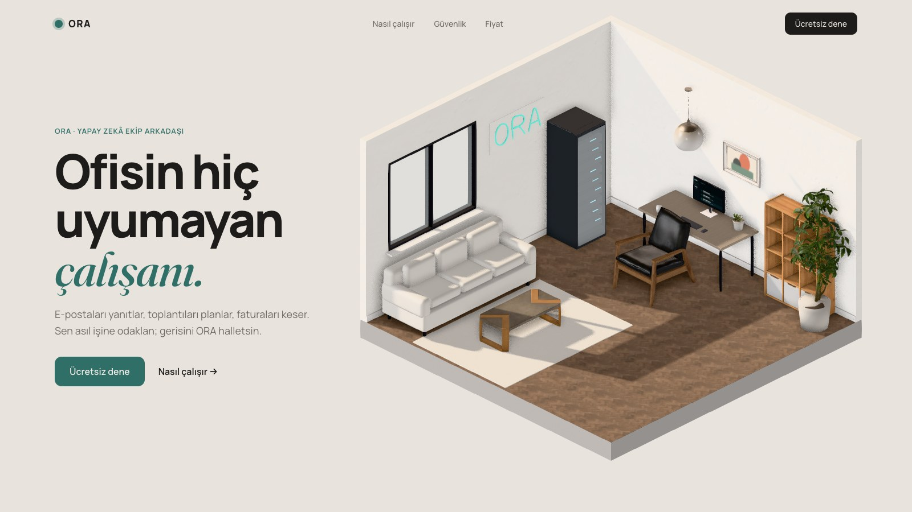

# ORA · İzometrik 3D Ofis Sitesi



Hayali bir yapay zekâ girişimi (ORA) için izometrik 3D ofisli bir web sitesi. Oda Blender'da Python ile, kodla adım adım kuruldu. Site kaydırdıkça canlanıyor: kamera masaya, sunucuya ve kanepeye yaklaşıyor, sonra gündüzden geceye geçiliyor ve neon tabela yanıyor.

📺 Bu proje [Satır Satır Kod](https://www.youtube.com/@satirsatirkod) YouTube kanalında sıfırdan, satır satır kodlandı.

## Neler var?

- Blender'ı Python ile yönetip odayı kodla kurmak: duvarlar, pencere, masa, sunucu dolabı, buklé kumaş kanepe
- Poly Haven'dan gerçek dokular (balıksırtı parke, sıva, meşe, buklé) ve hazır modeller
- Draco ile sıkıştırılmış GLB (bütün oda 3 MB)
- Ortografik kamera ile izometrik görünüm, pencereden giren güneş ve yumuşak gölgeler
- Monitörde canlı çalışan arayüz (canvas dokusu), yanıp sönen sunucu LED'leri
- TubeGeometry ile gerçek boru gibi bükülmüş ORA neon tabelası
- Kaydırınca gündüzden geceye geçiş: ay ışığı, lamba, neon
- Açılışta parça parça kurulan oda animasyonu
- GTAO, bloom ve SMAA ile son işlem, 60 kare

## Kullanılanlar

Blender · Python · Three.js · GSAP · Lenis · Vite

## Çalıştırma

```bash
npm install
npm run dev
```

Yayın için `npm run build`; çıktı `dist/` klasörüne yazılır.

3D odayı Blender'da yeniden üretmek için (Blender 4+):

```bash
blender -b -P blender/ofis_odasi.py -- "$PWD"
```

## Klasörler

- `src/`: sitenin kodu (sahne, ofis, monitör ekranı, neon tabela)
- `blender/`: odayı kuran Python betiği, dokular ve hazır modeller
- `public/`: hazır model (GLB), HDRI ve Draco çözücü

## Kaynaklar

Dokular, modeller ve HDRI [Poly Haven](https://polyhaven.com)'dan (CC0): herringbone_parquet, grey_plaster_02, mocha_oak_veneer, wool_boucle, modern_arm_chair_01, modern_ceiling_lamp_01, modern_coffee_table_01, wooden_display_shelves_01, hanging_picture_frame_02, potted_plant_04, pachira_aquatica_01, studio_small_09.

ORA hayali bir şirkettir; bu proje bir tasarım çalışmasıdır.

## Lisans

Kod [MIT](LICENSE) lisanslıdır. Poly Haven varlıkları CC0, Draco çözücü (`public/draco/`) Apache 2.0 lisanslıdır.
